# ANPR on i.MX95: Engineer's Learning Guide

Audience: an embedded firmware / Linux developer who is new to NPUs, to model quantization, and to this repository (which was largely built by AI agents). Goal: after reading this you can explain every stage of the system, run the model-conversion flow yourself, read a Neutron graph, and debug the typical problems.

How to use this file with an AI agent: paste it (or point the agent at `docs/learning-guide.md`) and ask it to quiz you, to walk you through a section against the real source, or to answer "why" questions. Facts here come from the repo (`docs/`, `tools/host/`, `src/anpr/`, `CLAUDE.md`) and are marked **[repo]**. Background knowledge that is general ML/NPU theory and not verified in this repo is marked **[general]**. Numbers (fps, ms) are measurements recorded in the repo notes on one bench setup, not guarantees.

Contents

1. The system in one page
2. Hardware and board software stack
3. Repository map and coding conventions
4. Runtime pipeline in detail
5. Recognition logic (post-processing around the models)
6. Model background you need (without training)
   6B. Model architecture deep-dive: detector, OCR-XS, OCR-S
7. Quantization and calibration: why 100 images
8. The NPU: Neutron, delegates, graphs
9. The eIQ / Neutron toolchain, step by step
10. This project's two conversion flows (detector, OCR)
11. Reading and verifying a compiled graph
12. Deploying to the board and verifying the NPU is really used
13. Day-to-day workflows (cheat sheet)
14. Gotchas and troubleshooting catalogue
15. Glossary
16. Self-test questions and exercises

---

## 1. The system in one page

**What it does [repo]:** reads an RTSP camera stream, finds license plates in each frame (detector), reads the text on each plate (OCR), fuses reads over time (voting), and shows the result in a web page. Runs on an NXP FRDM i.MX95 board.

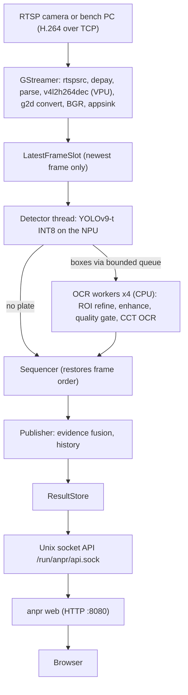

Key design facts:

- Two models. A **detector** (finds where plates are) and an **OCR** (reads a 128x64 crop). Both are pretrained and downloaded; this project does **not** train anything. It *converts and quantizes* them.
- The **detector runs on the NPU**. The **OCR runs on the CPU** (INT8 ONNX), because static INT8 of its attention layers lost too much accuracy and attention softmax/matmul cannot run on the NPU anyway.
- One thread owns the TFLite interpreter (detector). Frames that arrive too fast are dropped, never queued.
- All thresholds, paths, and pipeline strings are in one JSON config.
- Pure-stdlib Python package (`dependencies = []`). Heavy libs (`tflite_runtime`, `onnxruntime`, `cv2`, `gi`) exist only on the board/host and are imported lazily.

---

## 2. Hardware and board software stack

**Board [repo]:** FRDM i.MX95, machine `imx95-15x15-lpddr4x-frdm`, image `imx-image-full`, distro `fsl-imx-wayland`, Linux `6.18.37-2.1.0` (NXP BSP "LF 6.18 / wrynose"), Python 3.14.

### The NPU: eIQ Neutron

- The i.MX95 integrates the **eIQ Neutron NPU**. Linux exposes it as `/dev/neutron0` (kernel driver). Permissions: group `video`, mode `0660`, kept by udev rule `deploy/udev/99-anpr-neutron.rules`. The service runs as user `anpr` in group `video`, otherwise it cannot open the device.
- Userspace pieces on the board **[repo]**:
  - `/usr/lib/libNeutronDriver.so` from the `neutron` package (version 3.x). Talks to the kernel driver.
  - `/usr/lib/libneutron_delegate.so`: the **TFLite external delegate** (package `tensorflow-lite-neutron-delegate` 2.19.0). This is what `tflite_runtime` loads. Use this one.
  - `/usr/lib/liblitert_neutron_delegate.so`: the **LiteRT** delegate. Different ABI. **Do not pass it to `tflite_runtime`.** `probe-npu` only reports it.
- The NPU executes **pre-compiled microcode**. The model must be compiled offline on the host for the exact NPU target and driver version. The board does not compile models.
- **Version coupling:** host `eiq-neutron-sdk` version must equal the board Neutron driver version (3.2.1 here). Mismatch error at runtime: `Microcode version mismatch`. Fix: recompile with the matching SDK.
- **CMA memory:** the Neutron driver wants contiguous memory (default 4x512 MiB); the board's CMA is only about 960 MiB. `anpr.service` sets `NEUTRON_CMA_512SLOTS=1`. Without it, allocation can fail and things silently fall back to CPU.

### Video path

- Hardware H.264 decode: `v4l2h264dec` (V4L2 stateful decoder, Wave6 VPU, firmware `firmware-imx-vpu-wave`). Color conversion on the 2D GPU: `imxvideoconvert_g2d`.
- GStreamer 1.28, PyGObject (`gi`) for the app; OpenCV 4.13.imx with GStreamer support exists as fallback (`cv2.CAP_GSTREAMER`).

Pipeline string actually used **[repo `capture.py`]**:

```text
rtspsrc location=<uri> latency=100 protocols=tcp ! rtph264depay ! h264parse ! v4l2h264dec !
imxvideoconvert_g2d ! video/x-raw,format=RGB ! videoconvert ! video/x-raw,format=BGR !
appsink name=anpr drop=true max-buffers=1 sync=false
```

`appsink drop=true max-buffers=1 sync=false` means: never build a backlog, never wait for the clock. Latest-frame semantics begin at GStreamer, and `LatestFrameSlot` repeats the idea in Python.

### Bench setup

- A PC runs MediaMTX + ffmpeg (`tools/host/run-rtsp-server.sh`) and publishes an MP4 as `rtsp://<pc>:8554/videoCapture`. The board consumes it as if it were a camera.
- Known behavior: if the PC is not publishing, the board's decoder stalls and logs a banner every 5 s. This is not a bug in the app. Start the publisher first. The bench clip loops, which leaves gaps with no frames.

### Connections: who talks to whom

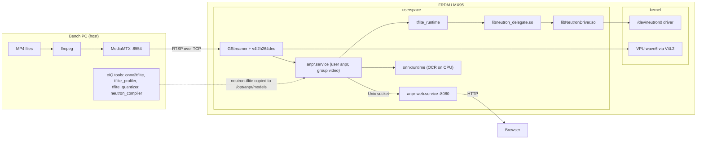

### Three trees, do not mix them [repo `docs/upstreams.md`]

| Tree | Role |
| --- | --- |
| `anpr-imx95` | This application. Edit freely. |
| `imx-docker` | Docker wrapper that builds the BSP. Leave alone on app tasks. |
| `yocto-builds` | `repo` checkout of the BSP sources. Leave alone. |

Host-side `neutron-converter`/eIQ toolkit are not on the board rootfs. A `meta-anpr` Yocto layer is planned only after the `/opt/anpr` install is proven.

---

## 3. Repository map and coding conventions

### Layout

```text
src/anpr/            application package (pure stdlib; heavy imports are lazy)
configs/             config.example.json (the single source of tunables)
deploy/systemd/      anpr.service, anpr-web.service
deploy/udev/         99-anpr-neutron.rules
tools/host/          HOST-ONLY: model download, quantize, Neutron conversion, graph report, RTSP server
models/              weights (gitignored), models/README.md tracked
datasets/calibration/images/   calibration frames (gitignored; >= 100 real frames)
datasets/videos/     bench MP4s (gitignored)
docs/                architecture.md, model-export.md, upstreams.md, this guide
tests/               tests/test_<module>.py, run on a plain host (no NPU/GStreamer/weights)
```

### Source modules (`src/anpr/`)

| Module | Role |
| --- | --- |
| `cli.py`, `__main__.py` | Commands: `check-config`, `run`, `web`, `probe-npu` |
| `config.py` | JSON -> dataclasses, validation (`ConfigError`) |
| `capture.py` | Builds GStreamer pipeline strings; opens them lazily via `gi` |
| `infer.py` | Finds delegates (`probe_delegates`), `load_interpreter` (TFLite + Neutron delegate) |
| `pipeline.py` | `LatestFrameSlot`, stream threads, wiring |
| `staged.py` | Detector thread, OCR worker pool, in-order sequencer |
| `publisher.py` | Releases frames in order into vote/history/result store |
| `recognize.py` | `PlateReader`: detector (ONNX or TFLite-Neutron), DFL decode, ROI refine, OCR, CTC |
| `roi_refine.py`, `quality.py` | Crop border snapping/perspective; blur/dark/bright gates |
| `ctc.py`, `fusion.py`, `vote.py` | CTC math, evidence fusion across frames, release logic |
| `plate_match.py`, `plates.py` | Alias matching of partial reads, plate text helpers |
| `results.py` | `ResultStore`, sticky history, fps measurement |
| `api.py`, `ipc.py`, `web.py`, `static/index.html` | Unix-socket HTTP API; web server and page |
| `sysmon.py` | CPU/RSS/NPU-busy reporting |

### Rules the repo enforces [repo `CLAUDE.md`, `.claude/rules/`]

- Thresholds, device paths, pipeline strings -> JSON config, never hard-coded. Adding a config key means updating `config.py`, `config.example.json`, `tests/test_config.py`, and README/architecture docs together.
- Imports of `tflite_runtime`, `gi`, `onnxruntime`, `cv2` go inside functions so the package imports on a bare host.
- Exactly one thread owns a TFLite interpreter.
- Python >= 3.11, ruff (E,F,I,UP), line length 100, stdlib `logging` not `print`.
- Verify before declaring done:

```bash
.venv/bin/ruff check src tests tools
.venv/bin/ruff format --check src tests tools
.venv/bin/pytest
.venv/bin/python -m anpr check-config --config configs/config.example.json
```

- Never commit weights (`*.pt`, `*.onnx`, `*.tflite`), calibration images, videos, MediaMTX files, or `auto.crt`/`auto.key`.
- Board IPs/accounts live in gitignored `CLAUDE.local.md`. Pushing, publishing RTSP, and changing the board need the user's go-ahead.
- Tick `ROADMAP.md` boxes only for things verified on hardware or by tests.

### Config structure (`configs/config.example.json`)

| Section | Contents |
| --- | --- |
| `streams[]` | `name`, `type` (`rtsp`/`rtp`/`v4l2`), `uri`, `enabled`, optional full `pipeline` override |
| `detector` | `path` (float ONNX), `npu_path` (Neutron TFLite), `delegate_path`, `conf_threshold`, input size 640x640 |
| `recognizer` | `enabled`, `model` (selector), `models{}` (each with `path` for CPU, `npu_path` for NPU mode), `charset`, confidence floors, `vote{}`, `quality{}`, `enhancer{}`, `roi_refine{}` |
| `service` | `runtime` (`cpu`/`npu`), `inference_fps_limit`, `api_socket`, `jpeg_quality`, `history_limit`, `ocr_workers` |
| `web` | `listen_host`, `listen_port`, `poll_seconds` |

**`service.runtime` is a mode switch, not proof of NPU use.** With `npu`, the detector loads the `.tflite` through the delegate; the OCR backend follows the file type (`.onnx` INT8 -> ORT CPU, Neutron `.tflite` -> delegate). Always verify actual NPU activity (section 12).

Model selection by config only: `recognizer.model` = `"s"` (CCT-S), `"xs"` (CCT-XS, faster), or `"xs_npu"` (XS compiled for Neutron). Restart `anpr` after changes.

---

## 4. Runtime pipeline in detail

### Processes and services

- `anpr.service` -> `python -m anpr run --config /etc/anpr/config.json`. Capture, inference, publishing. Listens only on a Unix socket, never TCP.
- `anpr-web.service` -> `python -m anpr web`. Serves the page on `0.0.0.0:8080`, reads the socket. Keeps running if `anpr` is down (shows last good frame + error).
- Install paths: `/opt/anpr` (code, `PYTHONPATH=/opt/anpr/src`, models in `/opt/anpr/models`), `/etc/anpr/config.json`.
- Logs: `journalctl -u anpr -u anpr-web -f`. `ANPR_LOG_LEVEL=DEBUG` adds per-request lines. The status line includes `runtime`, `det_ms`, `ocr_ms`, `cpu`, `rss_mb`.

### Threading model (`staged.py`)

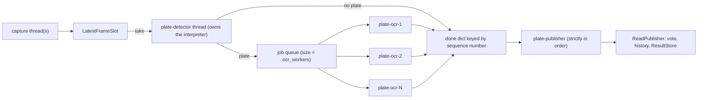

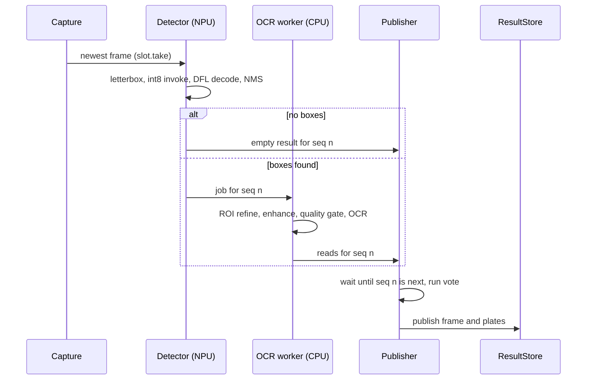

Why designed this way:

1. **Single detector thread owns the interpreter.** A TFLite interpreter is not thread-safe; one NPU device context. Detector work is small (about 43 ms).
2. **OCR is the slow part** (about 200+ ms on CPU), so N workers run it in parallel. They share one ONNX Runtime session, each with 1 intra-op thread (parallelism across frames, not inside a frame).
3. **Sequence numbers + publisher** restore frame order, because workers finish out of order and the vote logic needs order.
4. **Backpressure by dropping:** the job queue is bounded to `ocr_workers`. If all workers are busy the detector blocks, so capture slots overwrite stale frames. Latency stays bounded; the system shows the freshest data rather than a growing queue.
5. A frame that raises is marked failed and skipped; if a frame never finishes within 5 s the publisher skips it, so nothing stalls permanently.
6. `service.inference_fps_limit` throttles how often the detector takes a frame (board uses 30; the sample file says 2, which is a conservative default).

Measured on the board (repo notes): single-threaded about 3.4 fps; 3 workers about 9.4; 4 workers about 11.5 to 16 depending on build; 5 saturates the CPU. Detector about 43 ms, OCR about 200+ ms per frame in a worker.

### Detector stage specifics (`recognize.py`)

1. **Letterbox** the frame to 640x640 (aspect-preserving resize, pad with gray 114).
2. Input feeding: for the INT8 Neutron model with input scale 1/255 and zero point -128, quantized value = `pixel - 128` exactly. The code does a bit-trick on uint8 (`xor 128` viewed as int8) instead of building a float32 image. Same result, cheaper.
3. `interpreter.invoke()` on the NPU through the delegate; time is recorded in `npu_meter` (this is the "NPU busy" figure).
4. Read two outputs, dequantize with each output's own `(scale, zero_point)`: `real = (q - zp) * scale`.
5. `decode_dfl_head` in numpy (below) converts raw logits to boxes, only for anchors above the threshold.
6. `_boxes_from_yolo`: filter by threshold, undo the letterbox (subtract pad, divide by scale), clamp to the image, drop boxes smaller than 8 px, then run NMS in Python.

### What "DFL head" means (important for reading the model)

YOLOv8/v9-style heads predict each box side as a **distribution over 16 bins** (Distribution Focal Loss) rather than one number. **[general]** For each anchor point and each of 4 sides (left, top, right, bottom): 16 logits -> softmax -> expected value (sum of bin index x probability) = distance from the anchor in stride units. So the raw box output is `[1, 64, N]` (4 x 16 channels, N anchors). **[repo `decode_dfl_head`]:**

```text
distance = softmax(logits over 16 bins) @ [0..15]       # [K, 4] = l, t, r, b
x1y1 = anchor - (l, t);  x2y2 = anchor + (r, b)
center = (x1y1 + x2y2)/2 * stride;  size = (x2y2 - x1y1) * stride
```

N is the total anchors over the feature maps at several strides (for 640 input and `DETECTOR_STRIDES = (8, 16, 32)` that is 80^2+40^2+20^2 = 8400).

**Why the model is cut before this decode** (the central trick of this project, section 10): softmax, 1x1 conv and anchor arithmetic would run as CPU fallback ops inside the TFLite graph (slow, 38 ops -> 16 ops after the cut). Doing it in numpy on only the few anchors that pass the score threshold is far cheaper (detector about 110 ms -> about 43 ms).

### OCR stage specifics

- Input: 128x64 RGB uint8 NHWC crop. Resize uses `INTER_AREA` when shrinking, `INTER_LANCZOS4` when enlarging.
- Model: fast-plate-ocr **CCT** (Compact Convolutional Transformer). Full architecture in section 6B.
- Output (checked on the ONNX files): `plate` `[batch, 10, 37]` and `region` `[batch, 66]`. That is **10 fixed character slots**, each a softmax over the 37-symbol alphabet `0-9A-Z_`, where `_` is the *pad* that fills unused slots on the right. It is a slot classifier, **not** a CTC-trained model (the model's own config yaml calls the slots "classification heads").
- **Repo decode** (`plates.decode_characters`): argmax per slot, drop `_`, **collapse adjacent identical characters** (CTC style), plate confidence = minimum character confidence. See the warning in section 6B about the collapse step.

---

## 5. Recognition logic (post-processing around the models)

This code is what turns noisy per-frame guesses into a stable plate number. All of it is classical code you can read and tune without retraining.

1. **ROI refine** (`roi_refine.py`): detector boxes are often slightly off horizontally. Search from 20% inside to 20% outside each left/right edge for the outermost strong plate-frame edge and snap to it, then pad 5%. Optional perspective warp of a four-corner quad (off by default).
2. **Enhancer** (optional, on in sample): CLAHE (local contrast), gamma 1.1, mild sharpen. Must still output 128x64 RGB uint8 with no Python normalization (the model has normalization built in).
3. **Quality gate** (`quality.py`): reject crops that are blurry (variance of Laplacian < 40), too dark (< 40) / bright (> 220), or low-contrast (< 25) before wasting OCR time or poisoning the vote.
4. **Confidence floors:** `min_confidence`, `min_char_confidence` (0.70 default). The NPU path subtracts 0.005 because INT8 slightly lowers confidences.
5. **Temporal evidence fusion** (`ctc.py`, `fusion.py`, `vote.py`): per tracked plate (boxes matched across frames by IoU), keep a pool of candidate texts (greedy read plus CTC prefix-beam candidates). Score every candidate against the last 16 frames with the **CTC forward likelihood** (how likely is this text given this frame's probabilities), floor at `null_logp`, add an "unknown" hypothesis, scale by `evidence_weight` (frames are correlated, not independent), and weight frames by `1/(1 + quality_slope * mean_entropy)` (confident frames count more). Release when the leading candidate's posterior reaches 0.9. A crisp contradicting frame withholds release rather than flipping the result. The published confidence is that posterior.
   - Compare with naive majority voting: a truncated read ("AKW568" vs "CAKW568") costs the right candidate only a bit of evidence instead of casting a wrong vote.
6. **History / aliasing** (`results.py`, `plate_match.py`): up to `history_limit` distinct plates; partial reads (prefix/suffix, one char dropped) update the matching slot with the best text and crop.

Known limit **[repo]**: below about 130 px plate width the XS/CCT models drop the leading glyph (bench plate CAKW568 reads as AKW568). That is a **resolution limit of the input pixels**, not a voting or NPU bug.

### Vote flow

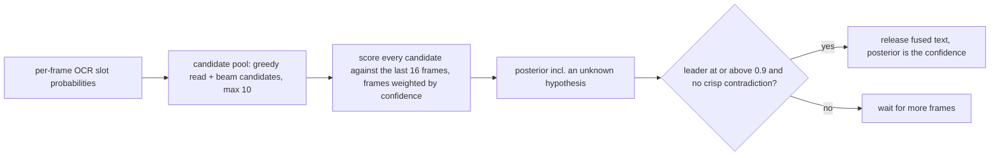

### Web/API (`api.py`, `web.py`)

```text
GET /health   GET /v1/latest   GET /v1/latest.jpg   GET /v1/history   GET /v1/history/<id>.jpg
```

Unix socket HTTP. A plate object: `text`, `confidence`, `characters[{char, confidence}]`, `box{x,y,width,height,confidence}`. `/v1/latest` also reports `runtime`, `det_ms`, `ocr_ms`, `fps` (frames published/second over 3 s window). POST `/api/reset` clears history and vote memory. Quick check on the board:

```bash
curl --unix-socket /run/anpr/api.sock http://localhost/v1/latest
```

---

## 6. Model background you need (without training)

### What each model is

| Model | Task | Architecture | Input | Output |
| --- | --- | --- | --- | --- |
| Plate detector | Find plate rectangles | YOLOv9-t (tiny), "end2end" license-plate model from `open-image-models` | 640x640 RGB | boxes + 1 class score per anchor |
| OCR | Read the characters | CCT-S / CCT-XS "v2 global" from `fast-plate-ocr` | 128x64 RGB uint8 | 10 slots x 37 class probabilities, plus a 66-way region head |

Both are downloaded float (FP32) ONNX files (`tools/host/fetch_models.sh`). Our work is **conversion + quantization + compilation**, not learning.

### Concepts in two minutes **[general]**

- **Neural network = a graph of operators** (Conv, Add, Softmax, MatMul, Reshape...) with weights. Inference = executing the graph.
- **Formats:** *ONNX* is the portable interchange format (also what ONNX Runtime executes). *TFLite* (`.tflite`, FlatBuffers) is the mobile/embedded format; it is what the Neutron compiler consumes and what `tflite_runtime` runs. Conversion ONNX->TFLite (`onnx2tflite`) maps ops one by one, and layouts change (ONNX is NCHW; TFLite is NHWC), which can add Transpose ops.
- **Anchor-based/grid detectors (YOLO):** the network outputs a fixed grid of predictions (N anchors). Each has a box and a score; most scores are near 0. Post-processing = keep high scores, decode boxes, de-duplicate (NMS). Detector cost is fixed per frame regardless of plates.
- **Why a detector then OCR (two-stage):** detector localizes cheaply at 640x640; OCR reads a tiny tight crop at 128x64, much better than reading whole frames.
- **Slot classification vs CTC:** the OCR here predicts a fixed number of character slots (10); each slot is an independent softmax over the alphabet, with `_` as right padding. **CTC** is a different scheme (variable-length output over T steps, blank symbol, repeat collapsing). This repo's decoder and fusion code apply CTC-style logic on top of the slot output, which works for typical plates but has a weakness with doubled characters (section 6B). The per-slot probabilities carry uncertainty, which the fusion step exploits.
- **Attention (transformer) blocks:** Q, K, V linear projections, `softmax(Q K^T)` then multiply V. Linears map well to NPUs; softmax and the activation-by-activation matmuls generally do not on Neutron, so they stay on the CPU (see 10.2).
- **FP32 vs INT8:** FP32 weights/activations -> 8-bit integers = 4x less memory, far less bandwidth, integer MAC arrays (which is what an NPU is). Costs a little accuracy. Next section.

### Why not just run it on the CPU?

Measured on this board (repo notes): detector float CPU about 970 ms, INT8 CPU about 245 ms, NPU about 43 ms (after the head split and host-side decode). OCR: S model CPU about 295 ms, XS INT8 CPU about 73 ms, XS on NPU about 40 ms but lower accuracy than S.

---

## 6B. Model architecture deep-dive: detector, OCR-XS, OCR-S

Everything in this section was measured by loading the ONNX files in `models/` with the `onnx` Python package (op counts, tensor shapes, parameter counts), then cross-checked against `docs/model-export.md`. Where something is inferred rather than read from the graph, it says so. To reproduce the numbers:

```bash
.venv/bin/python - <<'PY'
import collections, onnx
from onnx import numpy_helper
for p in ["models/plate_detector.onnx", "models/cct_xs_v2_global.onnx", "models/cct_s_v2_global.onnx"]:
    g = onnx.load(p).graph
    ops = collections.Counter(n.op_type for n in g.node)
    params = sum(numpy_helper.to_array(i).size for i in g.initializer)
    print(p, len(g.node), "nodes", f"{params/1e6:.2f}M params", dict(ops.most_common(8)))
PY
```

### Side-by-side

| | Detector (YOLOv9-t) | OCR CCT-XS | OCR CCT-S |
| --- | --- | --- | --- |
| Job | Find plate boxes in a 640x640 frame | Read a 128x64 crop | Read a 128x64 crop (more accurate) |
| Parameters | 3.05 M | 0.79 M | 1.26 M |
| FP32 ONNX size | 12.3 MB | 3.3 MB | 5.3 MB |
| INT8 ONNX size | (none; NPU TFLite instead) | 1.4 MB | 2.2 MB |
| ONNX nodes | 232 | 359 | 432 |
| Dominant ops | 64 Conv, 57 Sigmoid+Mul (SiLU) | 67 MatMul, 81 Add, 15 Tanh, 11 Softmax | 83 MatMul, 101 Add, 19 Tanh, 13 Softmax |
| Input | `[1,3,640,640]` float, RGB 0..1, NCHW | `[N,64,128,3]` uint8 RGB, NHWC | same |
| Outputs | `output0 [1,5,8400]` | `plate [N,10,37]`, `region [N,66]` | same |
| Embedding width | n/a | 96 | 112 |
| MLP hidden width | n/a | 384 | 448 |
| Attention heads | n/a | 2 (token reducer: 2) | 2 (token reducer: 4) |
| Tokens attended by the main self-attention | n/a | **65** | **512** |
| Main self-attention blocks | n/a | 3 | 5 |
| Conv stem channels | n/a | 32, 48, 64, 80, 96 | 48, 80, 96, 112 |
| Downsampling in the stem | strided convs, 3 scales | 2 max-blur-pool stages | 1 max-blur-pool stage |
| Neutron NPU result [repo] | 2 NeutronGraph ops + CPU tail (older: 1 of 42 nodes) | 23 NeutronGraph ops, attention on CPU | convertible with the same tool, but most of its work (5 layers of 512x512 attention) stays on the CPU, so it is not run on the NPU |
| Board speed [repo] | about 43 ms (NPU) | about 40 ms NPU / about 73 ms CPU INT8 | about 295 ms CPU |

### The detector: YOLOv9-t

What the graph contains and what it means:

- **64 Conv + 57 Sigmoid/Mul pairs.** Each Conv is followed by SiLU (`x * sigmoid(x)`), the activation used throughout YOLO. BatchNorm has already been folded into the convs, which is why there is no BatchNorm op. 56 SiLUs plus one plain Sigmoid for the class score.
- **8 Split, 17 Concat, 8 Add.** These are the GELAN/ELAN blocks of YOLOv9: split the channels, push one part through a few convs, concatenate the branches back, with residual Adds inside. This is the part that does feature extraction; cheap in parameters, heavy in convolution MACs, which is exactly what an NPU is good at.
- **3 MaxPool.** The pooling pyramid at the end of the backbone (SPP-style) that widens the receptive field.
- **2 Resize.** Nearest-neighbour upsampling in the neck (FPN/PAN): deep, coarse features are upsampled and merged with finer ones, so small plates are still seen.
- **Three output scales.** Strides 8, 16, 32 give grids of 80x80, 40x40, 20x20, which is **8400 anchors** (6400+1600+400). Small plates are found on the stride-8 grid, big ones on stride 32.
- **Head: decoupled, DFL box branch + 1-class branch.** One branch outputs 64 channels per anchor (4 box sides x 16 DFL bins); the other outputs 1 channel (plate score, sigmoid).
- **Tail ops: 1 Softmax, 1 Div, 2 Transpose, 2 Slice, 2 Sub.** This is the DFL decode and anchor arithmetic that turns the 64 logits into `cx, cy, w, h`. In the stock model it is baked in and the final `Concat` gives `output0 [1, 5, 8400]` = (cx, cy, w, h, score) per anchor.

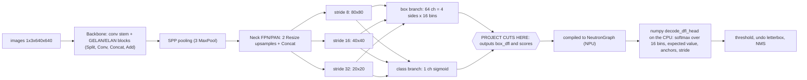

Why this matters for you day to day:

1. **Everything left of the cut is Conv-heavy and quantizes well.** That is why the detector is the good NPU citizen.
2. **The tail (softmax over 16 bins, 1x1 conv, anchor math, NCHW<->NHWC reshapes) is what the NPU cannot do well**, so it was 36 CPU ops in the compiled graph. The fix was to cut the ONNX earlier and do that math in numpy only for anchors above the score threshold.
3. **Box values (0..640) and scores (0..1) have wildly different ranges.** This is why they must be separate output tensors (own INT8 scale each). Joined, every score quantized to 0.
4. The detector is single-class and runs the same cost per frame whether or not a plate exists.
5. The file is named "end2end" upstream, but its output is still raw per-anchor candidates; this repo does the threshold and NMS itself in `_boxes_from_yolo`.

### The OCR models: CCT (Compact Convolutional Transformer)

Both OCR models are the same design at two sizes. Reading the graph front to back:

1. **Input** `[N,64,128,3]` uint8 RGB. Normalization is *inside* the model (the leading `Cast` and scaling), so the application feeds raw pixels. The input batch dimension is dynamic in the ONNX file; the NPU converter fixes it to 1.
2. **Conv stem** (the "Compact Convolutional" part): a handful of 3x3 convs with **max-blur-pooling** (a `MaxPool` with stride 1 followed by a stride-2 depthwise blur conv) for anti-aliased downsampling. XS uses five convs and two downsamples; S uses four convs and one downsample.
3. **Patch extractor**: a 2x2 stride-2 conv that turns the feature map into tokens of width 96 (XS) or 112 (S).
4. **Positional embedding** added to the tokens (a learned table sliced to the token count: 65 x 96 for XS, 512 x 112 for S).
5. **Self-attention transformer blocks** (3 in XS, 5 in S): each is multi-head self-attention (Q, K, V linears, `softmax(QK^T)`, multiply V, output linear) plus an MLP (width x4), with residual `Add`s. **Normalization is DyT (Dynamic Tanh)**, a `tanh(alpha*x)*gamma+beta` instead of LayerNorm, which is why the graph has many `Tanh` ops and no LayerNorm.
6. **Token reducer**: 10 **learned query tokens** (a constant `[1,10,dim]` tensor) cross-attend to all tokens. This squeezes the whole image down to exactly 10 tokens, one per character slot. This learned constant is the thing that made `neutron_compiler` abort with "Input index exceeds size" until constant-folded.
7. **3 more transformer blocks** over just those 10 tokens (tiny: `[2,10,10]` attention).
8. **Plate head**: a dense layer to 37 classes per slot + softmax = `plate [N,10,37]`. The softmax is *inside* the model, so the output is already probabilities.
9. **Region head** (a side branch): a transformer block, sequence pooling, dense to 66 classes = `region [N,66]`, the country/region of the plate (the 66 entries of `plate_regions` in `*_plate_config.yaml`, including `Unknown`). **The application ignores this output.**

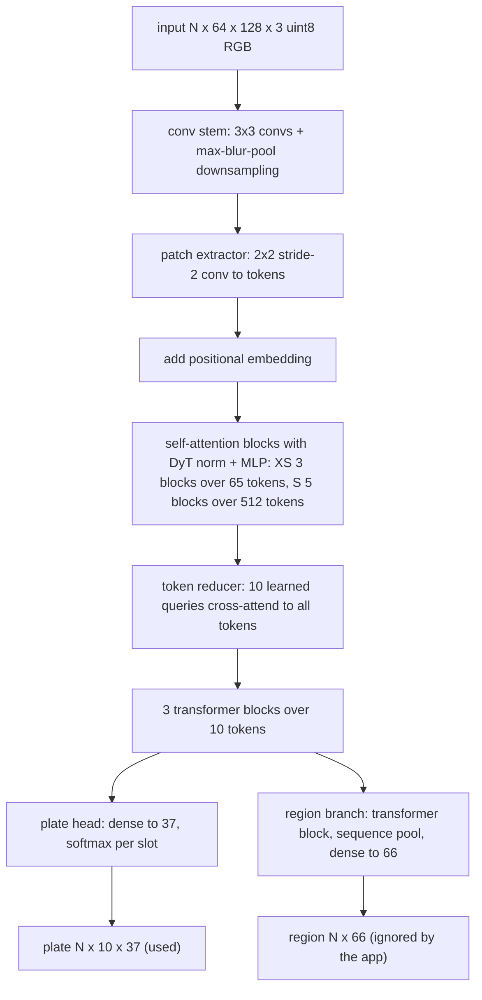

#### XS vs S: why one is 4x faster and less accurate

The two differ by **how many tokens the big attention layers look at**, not mainly by width:

| | XS | S |
| --- | --- | --- |
| Stem downsampling | 2 stages | 1 stage |
| Tokens in main attention | 65 | 512 |
| Attention score matrix per head per layer | 65 x 65 = 4.2 k | 512 x 512 = 262 k (about 62x bigger) |
| Main attention layers | 3 | 5 |
| Total score-matrix work | small | about 100x XS |

- S keeps a fine spatial grid (512 tokens), so each glyph gets several tokens, and the learned queries can find the *first* character precisely. XS squeezes the image onto about 8x fewer tokens, so thin or small leading glyphs are lost. This is a **likely** explanation of the repo observation that XS reads `AKW568` where S reads `CAKW568`. It matches the numbers but I did not prove it by ablation.
- Attention cost grows with the **square** of token count. On the CPU that is the 295 ms (S) vs 73 ms (XS) gap measured on the board.
- Both are tiny by deep-learning standards (about 1 M parameters); the cost is the attention matmuls, not the weights.

#### Where the NPU can and cannot help the OCR

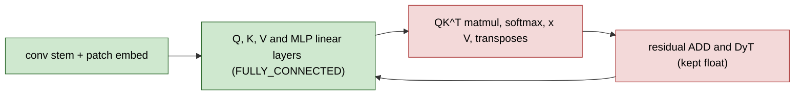

Green = compiled into `NeutronGraph` (INT8, NPU). Red = stays on the CPU. XS compiles to 23 NeutronGraph ops and the CPU part is small because attention is only 65x65. For S the CPU part (5 layers of 512x512 attention) is large, so moving S to the NPU would help little. This is the architectural reason the project keeps S on the CPU and treats `xs_npu` as the speed option.

#### Why INT8 hurts the OCR more than the detector

1. **Residual ADD + DyT**: adds two tensors with different ranges; INT8 `ADD` was outright wrong on Neutron here, so it stays float.
2. **Softmax and attention scores** have very large dynamic range; per-tensor static scales are coarse.
3. **Few calibration-relevant inputs**: only plate crops that really contain readable text exercise the right ranges (hence calibrating on 100+ real plate crops, not blank detections).
4. Weights-only quantization (the INT8 ONNX path) tracks float far better than static activation quantization.

#### Slot output and what the repo does with it

The model does **not** produce a CTC alignment. It produces 10 independent slot predictions with right-padding by `_`. Examples of the raw argmax seen on this repo's calibration frames (distant plates, 24 to 62 px wide):

```text
frame_003  S: __________   XS: __________      (no readable plate: all pad)
frame_055  S: CL________   XS: __________      (S: min slot confidence 0.12, rejected by the gates)
frame_077  S: 10MTTY____   XS: 1FNTT_____      (low confidence, adjacent identical slots "TT")
```

The repo decoder (`plates.decode_characters`) and the fusion code (`ctc.py`, CTC forward likelihood and prefix beam search) treat these slots as a CTC sequence: `_` as blank and **adjacent identical characters merged into one**. Two consequences:

- **Likely weakness, not yet tested on hardware:** a plate that really contains a doubled character (for example `AA12` or `4411`) occupies two adjacent slots with the same letter. The decoder merges them (`A12`, `411`), and the CTC likelihood used by the fusion step only accepts a doubled letter when a blank sits between the two copies, so the correct text is penalized. The bench plate `CAKW568` has no doubled character, so the bench cannot reveal this. **Action item:** test with a plate that has a double letter or digit before trusting the output on such plates. A slot-aware decoder (argmax per slot, strip only `_`) would not have this problem.
- **Confidence per slot is a plain softmax**, so the "min over characters" confidence and the entropy-based frame weights are meaningful and cheap to compute.

Also note the plate width limit: the crop is resized to 128x64 regardless of source size. A plate that is only 25 to 60 px wide in the frame is upscaled 2 to 5 times, which adds no information. Hence the observed limit of about 130 px for reliable reads.

### How the models connect in the pipeline

```mermaid
flowchart LR
  F["BGR frame"] --> LB["letterbox 640x640, pad 114"]
  LB --> DET["detector (NPU)"]
  DET --> BX["boxes in frame pixels"]
  BX --> RF["ROI refine: snap left and right edges, pad 5%"]
  RF --> RS["resize to 128x64 RGB"]
  RS --> OCR["OCR (CPU for S and XS INT8, or XS on NPU)"]
  OCR --> SL["10 slots x 37 probabilities"]
  SL --> DEC["decode + confidence gates"]
  DEC --> FUS["multi-frame fusion"]
  FUS --> OUT["published plate text + confidence"]
```

Two independent models, no shared weights, joined only by a crop. That is why you can swap OCR profiles from the config without touching the detector, and why a detector re-calibration never forces an OCR re-export (and vice versa), except that the OCR *calibration crops* are produced by the detector, so a changed detector or camera should refresh both.

---

## 7. Quantization and calibration: why 100 images

### The arithmetic **[general]**

INT8 *affine quantization*: each tensor has a `scale` (float) and `zero_point` (int8):

```text
real  = scale * (q - zero_point)          # dequantize
q     = clip(round(real / scale) + zero_point, -128, 127)   # quantize
```

Weights: scale known from the weights themselves (often per-output-channel). **Activations** (intermediate tensors) change with every input, so their ranges (hence scales) must be *estimated*. That estimation is **calibration**.

### Calibration flow

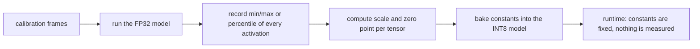

### Calibration = measuring activation ranges

Post-training static quantization (PTQ) works like this:

1. Run the FP32 model on a set of representative inputs.
2. Record the range (min/max or a percentile) of every activation tensor.
3. Pick `scale`/`zero_point` per tensor so that range maps onto -128..127.
4. Emit an INT8 model with those constants baked in. At runtime nothing is measured; the constants are fixed. ("Static".)

In this repo step 1 and 2 are `tflite_profiler` (it writes `model.profile.csv`) and step 3/4 is `tflite_quantizer`.

### Why real frames, and why at least 100

- **Scale = f(range).** If calibration frames never show a bright night plate or a dark one, tensors in those conditions exceed the learned range and **clip** (saturate), or the range is too wide and precision is wasted on rare outliers. The INT8 model silently gets worse. The NPU gives no error.
- **A handful of images gives noisy ranges.** One odd frame sets min/max for a layer. With about 100+ frames the ranges (especially percentile-based) are stable and cover the expected conditions: lighting, distance, plate styles, compression artifacts.
- **100 is a convention/floor, not magic.** It is a practical minimum that this project enforces in code (`MIN_CALIBRATION_IMAGES = 100` in `export_int8.py`, `convert_neutron_tflite.py`; the OCR converter requires 100 *crops*). More diverse data is better; 100 near-duplicate frames of one scene is worse than 100 varied ones.
- **Must be real data from the target camera**, not COCO: the input statistics (color, noise, sensor, H.264 artifacts, resolution, lighting, how big plates appear) define the activation ranges. A different camera = recalibrate.
- **Calibration data is also *content-dependent* for the OCR:** only 8 of 48 detector crops from the calibration frames were actually readable text. Calibrating the OCR on blank/unreadable crops gave bad scales. Fix: sample 200 frames from the video, run the real detector + ROI refine to get plate crops, add brightness/blur/shift variants to reach 100 (`convert_neutron_ocr.py --video`). Lesson: **calibrate on the distribution the model will really see at that layer, including what upstream stages produce.**
- **Percentile vs MinMax:** percentile (99) ranges ignore extreme outliers and slightly beat MinMax for the OCR.

### Things quantization breaks (seen in this project)

| Symptom | Cause | Fix |
| --- | --- | --- |
| Detector compiles, runs fast, never detects (score max exactly 0) | Boxes in 0..640 and scores in 0..1 in one `[1,5,N]` tensor share one INT8 scale (about 2.6); every score rounds to 0 | Split head into separate `boxes`/`scores` outputs, each with its own scale (`onnx_split_head.py`) |
| NPU OCR output is garbage; mismatch with its own pre-compile model (max diff about 0.95) | **INT8 `ADD` is wrong on the Neutron NPU** (found by bisecting layers) | Keep `ADD` (and `SOFTMAX`) in float: `--keep-float SOFTMAX,ADD` |
| Static INT8 OCR drifts from float | Per-tensor activation scales are too coarse for the conv stem and attention | Weights-only quantization tracks float much better; keep OCR on CPU (ONNX INT8) or use targeted calibration |
| Reads fine in float, worse in INT8 | Calibration set unrepresentative | Re-calibrate with real, varied data |

**Rule of thumb [general]:** accuracy is lost where a tensor has a wide dynamic range (outliers), where values of very different magnitudes share a scale (the score/box problem), and in residual additions and softmax/normalization.

### Validating a quantized model

Never trust "it compiled." The repo's loop: run the 100 calibration frames through float and quantized/NPU models and compare detections (float 48/100, NPU 43/100 on the bench set is acceptable; max score 0 everywhere is broken). For the OCR compare read agreement (INT8 reads the float text on 161 of 208 readable crops). Then compare on the **board** against float output. Where something is off, compare the pre-compile INT8 `.tflite` (run on CPU) with the compiled model (run via delegate) to separate quantization error from compiler/NPU error.

### When to re-quantize [repo]

| Change | Re-quantize? |
| --- | --- |
| New camera (sensor/lens/FOV/compression) | Yes: new >= 100 frames |
| Day/night/weather on same camera | Include those looks in the original set; if never calibrated, add and re-export |
| Threshold / enhancer / quality config only | No |
| New model weights or architecture | Yes (and re-validate) |

---

## 8. The NPU: Neutron, delegates, graphs

### Mental model

The Neutron NPU is a fixed-function integer accelerator. It accepts a **subgraph of supported INT8 operators** (convolutions, fully-connected/linear layers, some elementwise and pooling ops) compiled into a **NeutronGraph**: a single custom TFLite op containing NPU microcode + weights. Everything it cannot do stays as ordinary TFLite ops on the CPU. A model is therefore a **mix**: `NeutronGraph` nodes interleaved with CPU ops.

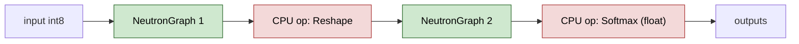

Every NPU<->CPU boundary costs data movement and a context switch. The best model has **few large NeutronGraphs and few CPU ops**.

### The delegate

A TFLite **delegate** is a plugin that takes over parts of the graph. Two ways Neutron appears:

1. **Offline compile (what this project uses):** `neutron_compiler` rewrites the `.tflite` so supported subgraphs are already `NeutronGraph` custom ops. At runtime `libneutron_delegate.so` executes those; the rest uses normal TFLite kernels.
2. **ONNX Runtime Neutron EP (tried and rejected):** claims only `NeutronGraph`/`MatMulInteger`-style ops; YOLO Convs are not claimed, so a plain INT8 ONNX stays on the CPU even though `runtime=npu` looks set. Hence the offline TFLite flow.

Loading it in code **[repo `infer.py`]**:

```python
from tflite_runtime.interpreter import Interpreter, load_delegate
delegate = load_delegate("/usr/lib/libneutron_delegate.so")
interp = Interpreter(model_path="plate_detector.neutron.tflite", experimental_delegates=[delegate])
interp.allocate_tensors()
```

Startup log should contain `NeutronDelegate delegate: N nodes delegated`. For the detector: "1 nodes delegated out of 42" in an early build; later builds: 2 NeutronGraph + ops on CPU.

### Why graph shape matters here

- **Only INT8 ops are accelerated.** Ops you keep float (SOFTMAX, DIV, ADD) stay on CPU. That is deliberate and fine when they are few.
- **Output tail:** the detector's DFL decode (softmax, 1x1 conv, anchor math, NCHW->NHWC reshapes) was 36 CPU ops. Cutting the graph at the raw logits removed them, which is why the final detector is about 43 ms.
- **OCR on NPU is partly CPU by construction:** the XS model compiles to 23 NeutronGraph ops (conv stem + patch embed in one; Q/K/V and MLP linears are others). The attention score/value matmuls, 11 softmaxes, transposes, and residual adds stay on CPU. Whole-model NPU invoke is about 10 ms of NPU time but the CPU part dominates.
- **Compile-time restrictions:** the compiler rejects constant-input FULLY_CONNECTED ops (learned query tokens) -> constant-fold first; dynamic batch -> fix batch=1; uint8 input `CAST` is mishandled -> use float32 input and let the quantizer produce a native INT8 input.

### Memory / device facts

- Needs `/dev/neutron0` access (group `video`).
- CMA size limits (see section 2). Failure mode: allocation falls back, runs on CPU, no crash.
- The delegate is not meant to be shared by many threads; one interpreter, one thread (the OCR `.tflite` variant shares one interpreter behind a lock, so 2 workers suffice).

---

## 9. The eIQ / Neutron toolchain, step by step

All of this is **host-side** (x86 PC). The board only runs the result.

### Components

| Tool | From | Job |
| --- | --- | --- |
| `eiq-neutron-sdk` (pip, pinned to board driver, e.g. 3.2.1) | NXP index `https://eiq.nxp.com/repository/` | Provides `neutron_compiler`, `tflite_profiler`, `tflite_quantizer` |
| `eiq-onnx2tflite` | NXP index | `onnx2tflite`: ONNX -> TFLite FP32 (NPU-friendly conversion) |
| `neutron-converter` (eIQ Toolkit installer) | NXP | Older/alternative converter. Referenced in roadmap/rules. Not a git remote, not on the board |
| `onnx`, `onnxruntime`, `opencv`, `numpy` | pip | Graph surgery, reference inference, calibration data prep |
| `tflite` (Python FlatBuffers bindings) | pip | `neutron_graph_report.py` reads the compiled model |
| `ai-edge-litert` (optional) | pip | Run quantized TFLite on host CPU for A/B comparison |
| `netron` | pip | GUI graph viewer |

Install (pins live in `requirements-host.txt`):

```bash
python3 -m venv .venv
.venv/bin/pip install -r requirements-host.txt
```

Large host tools go under `/run/media/arash/Projects/iMX95/host-tools/`, not `/opt` (it was full).

### The pipeline stages [repo `convert_neutron_tflite.py`]

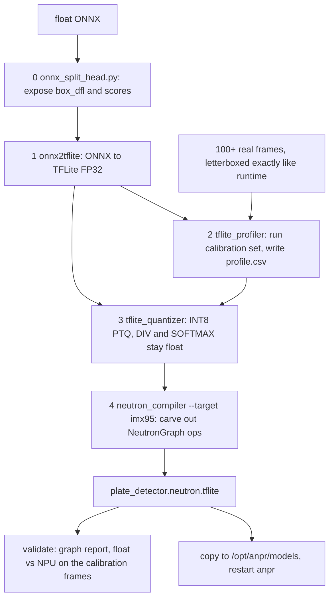

What to look at at each stage:

- **(0)** SplitError means the ONNX does not end in the expected two-input Concat with 4-ch boxes and 1-ch scores. A different detector needs a different surgery.
- **(1)** Check the output shapes and for unexpected `TRANSPOSE` pairs.
- **(2)** Calibration input is serialized as raw float32 `.bin` files, NCHW, RGB, 0..1, letterboxed exactly the way the runtime will (`_letterbox_nchw`). **Preprocessing must match runtime exactly**; a mismatch gives wrong ranges.
- **(3)** `--quantize-operator-types-except` lists operator types left in float (here `DIV,SOFTMAX`; the OCR also adds `ADD`).
- **(4)** Read the compiler log: the operator **conversion ratio** (how much moved to NPU), count of `NeutronGraph` ops, NPU latency estimate (`--dump-graphs` prints an "Overall statistics" block). "Microcode version mismatch" = SDK/driver mismatch.

Acceptance rule **[repo]**: keep the model only if the compiler log shows a high conversion ratio and at least one NeutronGraph. A log that leaves ops on the CPU through XNNPACK (a generic CPU path) means the export failed.

### Other scripts

| Script | Purpose |
| --- | --- |
| `fetch_models.sh` | Download float detector + OCR + plate config YAMLs into `models/` |
| `quantize_onnx_int8.py` | ORT static INT8 `.onnx` (QDQ) for CPU use: detector and OCR; uses `quantize_static` with a calibration reader |
| `export_int8.py` | Legacy Ultralytics path (`yolo export format=tflite int8=True data=...`). Mainly a **preflight guard**: refuses to run with < 100 images. Written for `.pt` weights; the project's actual detector flow is `convert_neutron_tflite.py` |
| `convert_neutron_ocr.py` | OCR -> Neutron TFLite (section 10.2) |
| `neutron_graph_report.py` | Lists each op as NPU/CPU for a compiled model |
| `run-rtsp-server.sh` | MediaMTX + ffmpeg publisher for the bench |

---

## 10. This project's two conversion flows

### 10.1 Detector (NPU)

```bash
.venv/bin/python tools/host/convert_neutron_tflite.py \
  --onnx models/plate_detector.onnx \
  --images datasets/calibration/images \
  --output models/plate_detector.neutron.tflite \
  --target imx95
```

Decisions baked in and why:

1. **Split head** (separate `box_dfl [1,64,N]` and `scores [1,1,N]`) so each output keeps its own INT8 scale.
2. **Cut at DFL logits** (`host_decode=True`) so softmax/conv/anchor math is not CPU fallback inside the model: 38 -> 16 ops, ~110 -> ~43 ms. The application decodes only high-score anchors (`decode_dfl_head`, verified against the ONNX head to 6e-5 px).
3. **DIV and SOFTMAX left float** so the CPU fallback can run them.
4. **Input quantization** with scale 1/255, zero point -128: runtime feeds `pixel - 128`.

Deploy: copy to `/opt/anpr/models/`, set `detector.npu_path` and `detector.delegate_path`, set `service.runtime` to `npu`, restart `anpr`.

### 10.2 OCR

Three variants available via config (`recognizer.model`):

| Profile | Format | Runs on | Accuracy / speed (bench, plate CAKW568, from repo notes) |
| --- | --- | --- | --- |
| `s` | float ONNX or INT8 ONNX | CPU | Best accuracy (reads CAKW568 on 101/119 candidates at >= 130 px), about 295 ms |
| `xs` | INT8 ONNX | CPU | Drops leading C, about 73 ms |
| `xs_npu` | Neutron TFLite | NPU+CPU mix | Same accuracy as xs INT8, about 40 ms (12 to 17 fps) |

```bash
.venv/bin/python tools/host/convert_neutron_ocr.py \
  --onnx models/cct_xs_v2_global.onnx --detector models/plate_detector.onnx \
  --video datasets/videos/IMG_9475.mp4 \
  --output models/cct_xs_v2_global.neutron.tflite
.venv/bin/python tools/host/neutron_graph_report.py models/cct_xs_v2_global.neutron.tflite
```

Extra steps vs the detector: fix batch=1 and constant-fold with onnxruntime; strip the uint8 `Cast` at the input; calibrate on real plate crops (detector + ROI refine on the calibration frames/video, + variants to reach 100); keep `SOFTMAX,ADD` float; report float-vs-INT8 read agreement (needs `ai-edge-litert`).

Current status per project notes: OCR stays on CPU for production quality (S INT8 ONNX or similar). The NPU OCR port keeps XS quality and cuts its time; it does not fix XS accuracy.

---

OCR conversion flow:

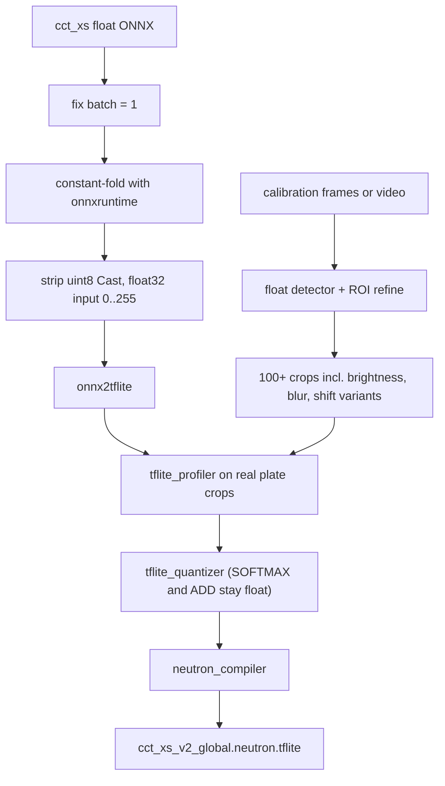

## 11. Reading and verifying a compiled graph

### Report script

```bash
.venv/bin/python tools/host/neutron_graph_report.py models/plate_detector.neutron.tflite
```

Output: model inputs/outputs with shapes, then one line per operator with `NPU` for `NeutronGraph` and `CPU` otherwise, then totals like `2 NeutronGraph (NPU), 14 other operators (CPU)`.

How to read it:

- Inputs: dtype/shape expected; INT8 `[1,640,640,3]` NHWC for the detector (TFLite layout).
- Outputs: the two split tensors. Check their quantization params at runtime (`get_output_details()[i]["quantization"]`).
- A long tail of small CPU ops after the last NeutronGraph = candidate to cut/move to host (that is how the DFL decode was found).
- Many alternating NPU/CPU/NPU/CPU = fragmentation; each boundary costs time.

### Netron GUI

```bash
netron models/plate_detector.neutron.tflite
```

`NeutronGraph` nodes are the NPU parts. Click a node to see input/output tensor types and quantization.

### Questions to ask any compiled model

1. How many NeutronGraph nodes, and what is on the CPU?
2. What are the input and output dtypes and quantization parameters?
3. Does the output tensor structure match the runtime decoder (`join_detector_outputs` accepts 1 joined, 4+1 split, or 64+1 DFL layouts)?
4. Do detections match float on the calibration frames?
5. Is the SDK version equal to the board driver version?

---

## 12. Deploying to the board and verifying the NPU is really used

### Probe and permissions (read-only checks are safe)

```bash
python3 -m anpr probe-npu      # on the board; fails on a dev host by design
ls -l /dev/neutron0            # root:video 0660
ls /usr/lib/*neutron*          # delegates + libNeutronDriver
```

Gotcha: never run plain `python3` over ssh with cwd `/opt/anpr/src/anpr`. The package's `types.py` shadows the stdlib `types` module.

### Deploy steps

1. Convert models on host (section 10).
2. Copy `.tflite`/`.onnx` to `/opt/anpr/models/`; keep a `.bak-<tag>` of the previous model (this project's convention).
3. Edit `/etc/anpr/config.json`; sample is `configs/config.example.json`.
4. `systemctl restart anpr`.

### Prove it ran on the NPU (a mode flag is not proof)

- Journal: `NeutronDelegate delegate: N nodes delegated`.
- `/v1/latest` has `det_ms` (about 43 ms expected for the detector) and `/v1/system` reports device per stage and NPU busy share.
- `neutron_perf.sh` (board tool) while frames flow: NPU load must rise above 0%.
- Compare reads against the float model on the board.

### Performance facts to remember

- Frames flow only when the bench publisher is up.
- fps ~ min(capture, `inference_fps_limit`, detector rate, workers x 1/ocr_ms). With 4 workers and ~230 ms OCR, expect around 16 fps at best.
- The OCR is the bottleneck, not the NPU. The roadmap's next item is a faster OCR or OCR on fewer pixels.

---

## 13. Day-to-day workflow cheat sheet

### Run host checks (always before finishing a Python change)

```bash
.venv/bin/ruff check src tests tools
.venv/bin/ruff format --check src tests tools
.venv/bin/pytest
.venv/bin/python -m anpr check-config --config configs/config.example.json
```

### Convert a new or changed model

1. Put >= 100 real frames in `datasets/calibration/images`.
2. `convert_neutron_tflite.py` (or `convert_neutron_ocr.py`).
3. Read compiler log: conversion ratio, NeutronGraph count, no microcode warnings.
4. `neutron_graph_report.py` for the NPU/CPU split.
5. Compare vs float on the calibration set on the host.
6. Deploy to the board, compare reads vs float on the board, check `det_ms`, NPU load.
7. Update `docs/model-export.md` and `models/README.md`; never commit weights.

### Swap OCR profile

Edit `recognizer.model` in `/etc/anpr/config.json` -> `systemctl restart anpr` -> look at the page footer.

### Tune without re-quantizing

Quality gate, enhancer, confidence floors, vote parameters, ROI refine: config only.

### Add a config key

`config.py` + `config.example.json` + `tests/test_config.py` + README/architecture docs together.

### Debug "no plates"

1. Frames flowing? (`/v1/latest` frame counter, journal banner every 5 s means the source is stalled.)
2. Detector max score exactly 0? -> head not split / bad quantization.
3. `conf_threshold` too high? (sample 0.70.)
4. Plate too small? (<~130 px wide loses leading glyph.)
5. Quality gate rejecting? (DEBUG log lists rejects.)

---

### Debug flow

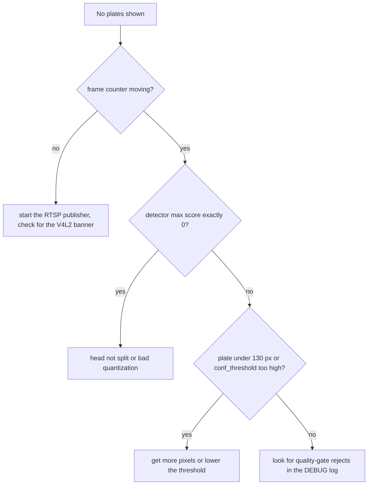

## 14. Gotchas and troubleshooting catalogue

| # | Symptom | Cause | Action |
| --- | --- | --- | --- |
| 1 | `runtime=npu` but CPU is busy, NPU load 0% | `runtime` is just a mode; CMA allocation failed or model not Neutron-compiled | Check `NEUTRON_CMA_512SLOTS=1`, delegate log line, compile the TFLite |
| 2 | `Microcode version mismatch` | `eiq-neutron-sdk` != board driver version | Reinstall pinned SDK (3.2.1), recompile |
| 3 | Detector never fires, max score = 0 | Joined `[1,5,N]` output shares one INT8 scale | Split head |
| 4 | OCR garbage on NPU, fine on float | INT8 `ADD` bug on Neutron | Keep `ADD` float; bisect layers vs pre-compile CPU model |
| 5 | `neutron_compiler` aborts "Input index exceeds size" | Constant-input FULLY_CONNECTED from learned tokens | Constant-fold with onnxruntime; fix batch=1 |
| 6 | Model compiles but ops remain on CPU via XNNPACK | Unsupported ops / not fully INT8 | Treat as failure for the detector; inspect graph; change op set or cut graph |
| 7 | `tflite_runtime` fails loading `liblitert_neutron_delegate.so` | Wrong delegate (LiteRT, not TFLite) | Use `libneutron_delegate.so` |
| 8 | Page shows 0 fps / frozen counter, journal V4L2DEC banner every 5 s | RTSP source not publishing | Start `tools/host/run-rtsp-server.sh <mp4>` |
| 9 | Frames stop for ~8 s periodically | Bench clip looping | Not a fault |
| 10 | Leading char missing (AKW568 vs CAKW568) | Plate box < ~130 px wide; OCR input resolution | Get more pixels, not more voting |
| 11 | Accuracy fell after changing camera/lighting | Calibration set no longer representative | Re-collect >= 100 frames, re-export |
| 12 | Strange stdlib import error when running python on board in `/opt/anpr/src/anpr` | `types.py` shadows stdlib | Run from another cwd |
| 13 | fps lower than before after a voting change | Fusion adds CPU work in the publisher | Not yet investigated (project notes) |
| 14 | Everything compiles but results differ on board vs host | Preprocessing mismatch (letterbox pad value, RGB vs BGR, NHWC vs NCHW) | Make calibration preprocessing identical to runtime |
| 15 | `anpr` cannot open `/dev/neutron0` | Not in group `video` / udev rule not applied | Fix udev rule or group |

Cross-checks that find most NPU bugs: (a) float vs quantized-CPU vs compiled-NPU on the *same* inputs; (b) bisect by cutting the graph at successive layers; (c) check output dtype and quantization params; (d) change one thing at a time.

---

## 15. Glossary

- **ANPR / ALPR:** automatic number/license plate recognition.
- **Anchor:** a fixed grid location at which a YOLO head makes one box prediction.
- **CCT:** Compact Convolutional Transformer; conv stem + attention.
- **CMA:** Contiguous Memory Allocator; physically contiguous RAM for DMA devices like the NPU.
- **Calibration:** measuring activation ranges on representative data to set quantization scales.
- **CTC:** loss/decoding scheme for sequences without alignment; blank + repeat collapse. The OCR models here are slot classifiers; the repo only applies CTC-style decoding on top.
- **Slot head:** one fixed output position of the OCR (10 of them), a softmax over 37 symbols.
- **DyT:** Dynamic Tanh, `tanh(alpha*x)*gamma+beta`, used instead of LayerNorm in the CCT blocks (the many `Tanh` ops in the graph).
- **Delegate:** TFLite plugin executing part of a graph on an accelerator.
- **DFL:** Distribution Focal Loss; box edges as 16-bin distributions.
- **Dequantize / quantize:** convert between int8 and float via scale and zero point.
- **eIQ:** NXP's ML software ecosystem (toolkit, Neutron SDK).
- **FlatBuffers:** serialization format of `.tflite`.
- **Letterbox:** aspect-preserving resize with padding.
- **LiteRT:** Google's new name for TFLite runtime; its delegate ABI differs.
- **MAC:** multiply-accumulate; NPU throughput unit.
- **Microcode:** the compiled NPU program inside a NeutronGraph; versioned against the driver.
- **NeutronGraph:** custom TFLite op holding an NPU-compiled subgraph.
- **NCHW / NHWC:** tensor layouts (batch, channel, height, width) vs (batch, height, width, channel).
- **NMS:** non-maximum suppression; removes duplicate boxes.
- **ONNX / ORT:** interchange format / ONNX Runtime.
- **PTQ:** post-training quantization (this project). Contrast QAT (quantization-aware training; needs training).
- **QDQ:** quantize/dequantize node style of quantized ONNX.
- **ROI:** region of interest, here the plate crop.
- **Scale / zero point:** affine parameters of an INT8 tensor.
- **Sequencer:** component restoring frame order after parallel workers.
- **XNNPACK:** TFLite's default optimized CPU kernel library (the fallback).

---

## 16. Self-test questions and exercises

Answer these (or have an agent quiz you), checking against the cited source.

Concepts

1. Why does a joined `[1,5,N]` detector output make every score 0 after INT8? What is the fix and where is it implemented?
2. Why is a calibration set of random COCO images not acceptable? What goes wrong silently?
3. Explain `real = scale * (q - zp)`. For input scale 1/255 and zp -128, why is `q = pixel - 128`?
4. Why must `eiq-neutron-sdk` match the board's driver version?
5. What is the difference between `libneutron_delegate.so` and `liblitert_neutron_delegate.so`?
6. Why does `service.runtime=npu` not prove the NPU is being used? List three ways to prove it.
7. Why is there exactly one detector thread but several OCR workers?
8. Why does the pipeline drop frames instead of queueing them?
9. Why was the DFL decode moved out of the model? What did it save?
10. Why does the OCR on the NPU still spend most of its time on CPU?
11. What does the fusion vote do that a majority vote does not? (And what does its CTC assumption get wrong for slot outputs?)
12. What happens to accuracy when the plate box is narrower than about 130 px, and why is more voting not the cure?

Hands-on (in this order; all read-only unless noted)

1. Run the four host checks and read what each does.
2. `.venv/bin/python tools/host/neutron_graph_report.py models/plate_detector.neutron.tflite`; count NeutronGraph vs CPU ops and name the first CPU op after the last NeutronGraph.
3. Open the same file in `netron`; compare with the report. (Note: the local detector file may be the older single-output build per the project notes; compare with `cct_xs_v2_global.neutron.tflite` as well.)
4. Read `decode_dfl_head` in `src/anpr/recognize.py`, and `tests/test_onnx_split_head.py` to see how the split is tested.
5. Read `src/anpr/staged.py` and draw the thread diagram from memory.
6. Run `python -m anpr check-config --config configs/config.example.json`; change a value to something invalid and read the `ConfigError`.
7. (Needs board + bench publisher, with go-ahead) Watch `journalctl -u anpr -f` and `/v1/latest` while changing `ocr_workers` from 3 to 4; note fps and `ocr_ms`.
8. (Needs host SDK) Re-run `convert_neutron_tflite.py --keep-work /tmp/work` and open each intermediate file (FP32 tflite, profile CSV, PTQ tflite, final) in Netron to see where `NeutronGraph` appears.

Further study order for an embedded engineer: (1) TFLite interpreter/delegate API; (2) affine quantization (per-tensor vs per-channel); (3) the YOLO head layout; (4) CTC; (5) NXP eIQ Neutron SDK documentation for supported operators and `neutron_compiler` options (not vendored in this repo; consult the SDK's own docs for the full flag list, since this guide only documents flags that this repo uses).
